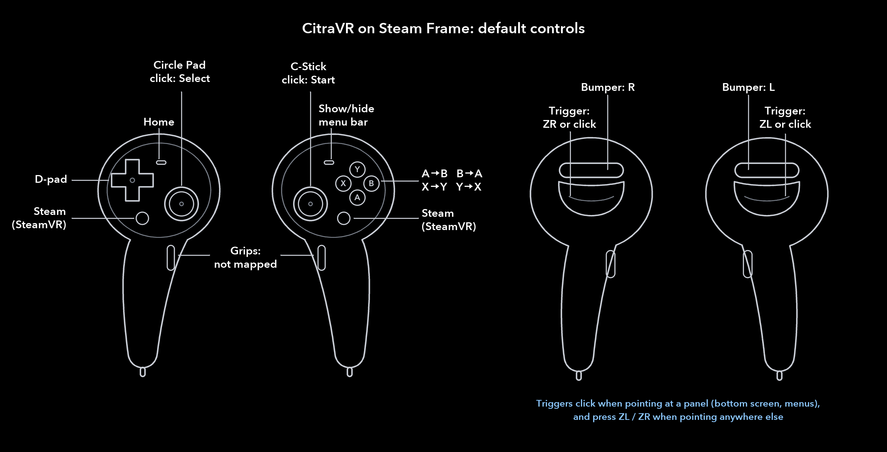
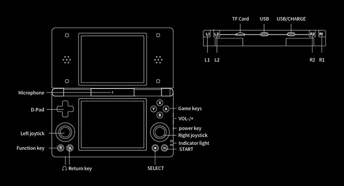
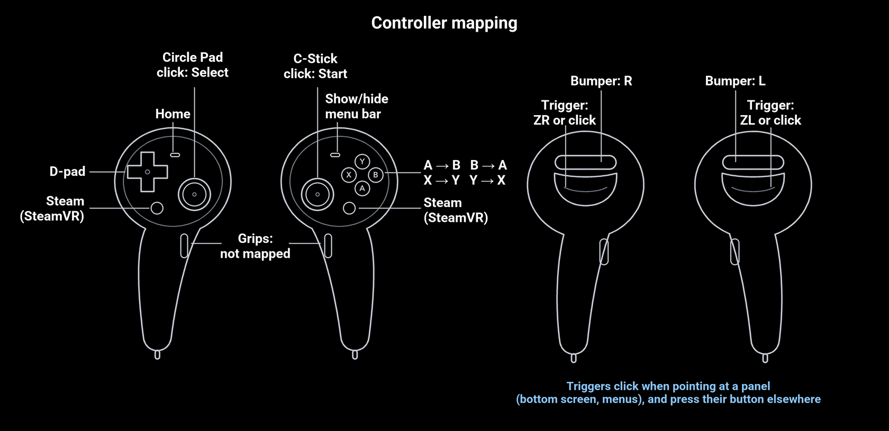

<h1 align="center">
  <br>
  <a href="https://github.com/amwatson/CitraVR"></a> (Beta)
</h1>

<h4 align="center"> Play 3DS homebrew and personal game backups in 3D on the go with your Quest.
</br>
  CitraVR is a GPL-licensed, engineless OpenXR application with all source code publicly available.
</h4>

<p align="center">
  <a href="#steam-frame-edition">Steam Frame Edition</a> |
  <a href="#installing-on-steam-frame">Installing on Steam Frame</a> |
  <a href="#compatabillty">Compatibillty</a> |
  <a href="#releases">Releases</a> |
  <a href="#known-issues">Known Issues</a> |
  <a href="#how-to-install-and-run">How to Install and Run</a> |
  <a href="#building">Building</a> |
  <a href="#discord">Discord</a> |
  <a href="#need-help">Need Help?</a> |
  <a href="#support">Support</a> |
  <a href="#license">License</a>
</p>

> **This is a fork of [amwatson/CitraVR](https://github.com/amwatson/CitraVR), focused on making CitraVR run on the Valve Steam Frame.** It keeps Quest support and adds a Steam Frame edition, installed into the Frame's Steam library as **Citra VR - Steam Frame Edition**. See the **[Steam Frame guide](STEAM_FRAME.md)** to build and install it. Quest releases come from the original repository.

## Steam Frame Edition

**The primary goal of this fork is Steam Frame compatibility.** The Frame runs Android apps through **Lepton**, Valve's Android container on SteamOS, with **SteamVR** as the OpenXR runtime. Stock CitraVR doesn't start there, because it depends on Meta-only OpenXR extensions that SteamVR doesn't offer. This fork makes those optional, replaces the ones CitraVR can't do without, and adds what's needed to use CitraVR comfortably on the Frame.

**Status: experimental, running on a Steam Frame.** It has been tested with SteamVR/OpenXR 2.18.2 and Lepton (Android 11):
- the app installs into the Steam library;
- games boot in VR, with the Frame controllers;
- the in-game menu and the in-VR game list work;
- the ROM upload server is reachable from the network.

Passthrough and the immersive modes haven't been checked on the headset yet. The same APK still targets Quest.

**Quick start (Steam Frame):** turn on Developer Mode on the headset (with a password), then from any computer run `ssh steamos@frame.local "curl -fsSL https://github.com/SPD13/CitraVR-steam-frame/releases/latest/download/install.sh | bash"`. It installs the latest release into the headset's Steam library with its artwork. Details in [Installing on Steam Frame](#installing-on-steam-frame).

### What this fork adds

**Running on Steam Frame (SteamVR through Lepton)**
- **OpenXR extensions:** only `XR_KHR_opengl_es_enable` is required. Every Meta/FB extension is used when the runtime offers it and skipped or replaced when it doesn't. That covers cylinder layers, image-layout flip, layer settings, passthrough, performance settings and metrics, and thread settings. `XR_KHR_android_create_instance` is passed when offered.
- **Screens without surface-backed swapchains:** SteamVR doesn't offer `XR_KHR_android_surface_swapchain`. The game screens and all VR panels (menu bar, keyboard, error dialog) are instead drawn by Android into a `SurfaceTexture`, and each new frame is copied into a regular OpenXR swapchain (`vr/SurfaceSwapchain.cpp`). New frames are detected with a frame listener. Quest keeps its surface-backed swapchains.
- **Passthrough:** without `XR_FB_passthrough`, the app uses the alpha-blend environment mode, with a transparent projection layer behind the panels.
- **Steam Frame controllers:** native bindings through `XR_VALVE_frame_controller_interaction`. The face buttons are on the right controller (in the Nintendo layout by default), the 3DS d-pad on the left d-pad, L/R on the bumpers, and the right **Menu** button toggles the menu bar; the buttons can be remapped (see [Controller mapping](#what-this-fork-adds)). Action queries also follow the OpenXR spec strictly, which SteamVR requires and Quest didn't.
- **Headset detection:** Lepton (model `Lepton`) is recognised as Steam Frame, with the Quest 3 default resolution (3×).
- **Menu bar fix:** upstream's secondary-display feature drew the lower game screen over CitraVR's own VR panel displays, which hid the menu bar and its *Close Game* button. Those displays are now excluded.
- **Clean lower screen:** SteamVR depth-tests composition layers instead of drawing them in order as Quest does. The lower screen shared its plane with the menu bar's translucent background, and the two z-fought into a moving, CRT-like pattern of black pixels. The lower screen is now drawn just in front of the menu bar, and the pointer dot just in front of whatever it points at.
- **Sharp panels:** the top screens and the lower screen each get their own swapchain. The lower screen gets a filtered downscale to twice the 3DS resolution, since it's shown smaller than its texels. Every swapchain stays at most 1000 px tall, below the size Valve's injected foveated-rendering layer treats as an eye buffer.

**Controllers and pointer ray**
- **Controllers:** your controllers are drawn in VR, using SteamVR's own render models of the Steam Frame controllers, read from the headset's SteamVR install and placed with the models' `openxr_aim` reference, as SteamVR places them.
- **Pointer ray:** a ray runs from the pointing controller to the cursor, so you can see where you point. When it points at nothing, a short ray fades out.
- **Reliable clicks:** a press counts where you aimed just before pulling the trigger (the pull tilts the controller), and small hand movements while the trigger is held don't turn a click into a drag. Moving further still drags, e.g. to scroll a list.
- **Settings:** **Show controllers** and **Show pointer ray** in the VR settings turn each on or off (both on by default; they apply from the next game start).
- **How:** SteamVR on Steam Frame draws quad layers over projection layers whatever their order, so both are quad layers, which it sorts by depth among the panels. The ray is a thin quad along the ray, turned towards the head. Each controller is drawn, per eye, into a quad at the controller that faces that eye and is shown to it only, rendered from that eye's position so the stereo pair is exact. Where no model is found (e.g. on Quest), only the ray is drawn.

**Controller mapping (VR settings)**
- **The screen:** **Settings → VR → Controller mapping**, also in game from the menu bar's **Settings** tab. It lists the 3DS buttons (**[3DS] A**, B, X, Y, L, R, ZL, ZR, Start, Select, Home and the d-pad), each with the controller button that presses it. In VR, tapping a 3DS button asks you to press the controller button to use for it (or **None** to unmap it); the game doesn't receive that press. The 2D settings show a list to pick from instead.
- **One to one:** a 3DS button has one controller button, and a controller button presses one 3DS button: picking a button that was used elsewhere clears it there.
- **Mappable:** A, B, X, Y, the d-pad, both bumpers, both grips, both thumbstick clicks, both triggers, the left **View** button and the right **Menu** button. The thumbsticks (Circle Pad and C-Stick) keep their roles.
- **Menu bar:** showing/hiding the menu bar is a row of its own (**[VR] Show/hide menu bar**), on the Menu button by default, so it can move to another button. With no button for it, the menu bar stays shown, since it holds the settings.
- **Triggers:** a trigger pulled while its controller points at a panel (the bottom screen, the menu bar, the keyboard…) clicks, and that controller becomes the pointer. Pulled while pointing anywhere else, it presses its mapped 3DS button (ZL/ZR by default). The role is set when the trigger is pulled and kept until it's released. To map a trigger, point away from the menu (the game screens are fine) and pull it when asked.
- **Defaults (Steam Frame):** the Nintendo layout on the face buttons (the 3DS's B where the Frame's A is: A→B, B→A, X→Y, Y→X), the d-pad on the d-pad, L/R on the bumpers, Select/Start on the left/right stick clicks, ZL/ZR on the triggers, Home on the View button and the menu bar on the Menu button; the grips are free. Headsets without bumpers or a right Menu button (Quest) have L/R on the grips and the menu bar on the left Menu button.
- **Per game:** with **Per-game** selected in the in-game settings, the mapping is saved for the running game only. Changes apply right away, also mid-game.
- **Resets and copies:** **Reset to default** puts every button back on its default (globally, or for the game). With **Per-game** selected, **Apply to global** makes the game's mapping the global one, and **Use the global mapping** removes the game's own mapping.

**Controller diagram in VR**
- **Where:** a panel 90° to the left of the game shows the Steam Frame controllers: turn your head to check which button does what, without leaving the game.
- **Live labels:** the labels come from the mapping in use, per-game mapping included, and change as soon as you remap a button, also from the in-game settings.
- **3DS layout:** a panel 90° to the right shows the 3DS-style button layout, to compare.
- **Setting:** **Show controller diagram** in the VR settings (on by default) hides both panels, right away.

**One-question setup and folders that survive updates**
- **First launch:** when CitraVR has all-files access (always on Steam Frame), first launch asks a single question: *Do you want to manually configure Citra directories?* Answering **No** creates `/storage/emulated/0/CitraVR` (data) and `/storage/emulated/0/CitraVR/games` (games) and goes straight to the game list.
- **Plain paths:** CitraVR's folders are used as plain file-system paths rather than grants from Android's folder picker. Lepton drops picker grants on every app update; plain paths aren't affected. Folders picked earlier are switched to plain paths automatically.
- **Exact file names:** files created in plain-path folders keep their exact names (Android's document API would add `.bin`, which made per-game settings unreadable). Config files left with a `.bin` suffix by earlier builds are renamed at startup.

**Switching games without leaving VR (Steam Frame)**
- **The list:** on the Frame, *Close Game* no longer drops you into the Steam interface. It pauses the game and shows a **Choose a game** panel in VR, with your games and their icons.
- **Picking a game** restarts the VR part of the app on it, in about a second.
- **Back to game** resumes the current game; **CitraVR window** returns to the 2D app; **Quit** closes CitraVR altogether (the ROM upload server too, until the next start).

**ROM upload server (all headsets)**
- **The screen:** a **ROM server** item in CitraVR's left menu opens it, with the on/off switch, the address to open, the server status and the games folder. The server runs in the background (foreground service) until turned off, and restarts with the app if left on.
- **The page** at `http://<headset IP>:8338` lists the ROMs in the games folder with their sizes and the free space. You can delete ROMs and upload new ones by drag and drop, with progress shown.
- **Uploads** stream straight into the games folder, so any size works. The game list refreshes by itself. The settings show the address to open.

**Steam library integration (Steam Frame)**
- **One-command install:** releases on GitHub come with `install.sh`, which runs on the headset (over ssh): it downloads the release, checks it, and registers the APK with the Frame's Steam client as a title on the Lepton runtime, as Valve's devkit Title Upload does. It names it **Citra VR - Steam Frame Edition**, shows the 2D game list window, and installs library artwork. The same command updates it; `--uninstall` removes it.
- **`register-frame.sh`** does the same with an APK built from source, for development.
- **Releases:** `tools/make-release.sh` builds, signs (with the project's release key), packages and publishes them.
- **Library artwork:** capsule, wide capsule, hero banner, logo and icon, generated from the CitraVR logo by `steam-frame/make_library_art.py`.

**Development**
- **CI builds:** a GitHub Actions workflow builds the APK on every push.
- **Panel dumps:** `adb shell setprop debug.citra.dump_swapchains 1` saves what the app sends to the runtime for each VR panel, which helps debug visuals without wearing the headset. `2` saves the next 30 frames instead, and `debug.citra.dump_width` limits dumps to the panels of one width.
- **Lower screen resolution:** `adb shell setprop debug.citra.lower_panel_resolution <factor>` changes the lower screen's resolution while a game runs (multiples of 320×240, default 2, up to 3).
- **[STEAM_FRAME.md](STEAM_FRAME.md):** technical notes, install guide, testing checklist and known limitations.

**Known limitations on Steam Frame:**
- The curved screen and immersive modes fall back to the flat screen (no cylinder layers in SteamVR).
- There's no CPU/GPU clock control and no performance overlay.
- The library title keeps its own Android data, separate from Lepton Development.

## Controls



*Controller drawing: Valve, from the Steamworks documentation, relabelled with CitraVR's defaults (`steam-frame/make_controls_image.py`).*



*The 3DS-style button layout, for comparison: X at the top, A on the right, B at the bottom and Y on the left, as on a 3DS. In VR, this drawing is shown to the right of the game, opposite the controller diagram. (It's of the Anbernic RG DS, a DS-style handheld, from [omgmog's blog](https://blog.omgmog.net/), with its colours inverted, so its other labels, such as L2/R2 or the second joystick, don't match the 3DS.)*

| Steam Frame | 3DS / CitraVR |
|---|---|
| A, B, X, Y (right) | B, A, Y, X (the Nintendo layout) |
| D-pad (left) | D-pad |
| Left stick / click | Circle Pad / Select |
| Right stick / click | C-Stick / Start |
| Bumpers | L, R |
| Triggers | Pointer click, or ZL, ZR (see below) |
| Grips | not mapped |
| View (left) | Home |
| Menu (right) | Show/hide the menu bar |

**A/B and X/Y are swapped on purpose:** the Frame's buttons follow the Xbox layout (A at the bottom, B on the right), while the 3DS has A on the right and B at the bottom (and X at the top, Y on the left). Swapping them puts each 3DS button where it sits on a 3DS, so the Frame's B presses the 3DS's A, A presses B, Y presses X and X presses Y.

All of this can be changed in **Settings → VR → Controller mapping**, also in game from the menu bar's **Settings** tab (see [Controller mapping](#what-this-fork-adds)).

### Controller diagram in VR

In VR, turn your head to the left: a panel shows the controllers labelled with the current mapping, and it follows any change you make (per game too). Turn your head to the right for the 3DS-style button layout. **Show controller diagram** in the VR settings hides both.



### Pointing and clicking

One controller is the pointer: it shows a ray and a dot where it points. The triggers do two jobs, depending on where their controller points **when the trigger is pulled** (the choice holds until it's released):

- **On the bottom screen:** the trigger touches the 3DS touchscreen where the dot is. Holding it and moving is a stylus drag.
- **On a menu** (the menu bar beside the bottom screen, the game list, the keyboard, a message): the trigger clicks. A click counts where you aimed just before pulling (the pull tilts the controller), and small movements while it's held don't cancel it; moving further drags, e.g. to scroll a list.
- **Anywhere else** (the top screen, the room): the trigger is a game button, ZL on the left and ZR on the right by default. It doesn't click.

Pulling the *other* controller's trigger while it points at the bottom screen or a menu makes that controller the pointer; pulled anywhere else, it doesn't take over the pointer.

## Installing on Steam Frame

One command, run from any computer, installs the latest release on the headset: nothing to build. The app, your ROMs and your saves then live on the headset.

### 1. Prepare the headset

1. **Turn on Developer Mode:** in the headset, open **Steam Settings → System**, turn on **Developer Mode**, and set a **user password** when asked. This allows ssh access as the user `steamos`.
2. **Have a computer with ssh** on the same network: macOS, Linux and Windows 10/11 include it (on Windows, use PowerShell or Terminal).
3. **Keep the headset awake** while installing: when it sleeps it drops off the network.

### 2. Install

```sh
ssh steamos@frame.local "curl -fsSL https://github.com/SPD13/CitraVR-steam-frame/releases/latest/download/install.sh | bash"
```

Enter the Developer Mode password when asked. If `frame.local` doesn't resolve, use the Frame's IP address from its Wi-Fi settings instead (`ssh steamos@192.168.1.42 "…"`).

The installer runs on the headset. It downloads the latest release, checks it against the release's `SHA256SUMS`, and:

1. **Registers** the APK with Steam as a title on the **Lepton** (Android) runtime, the same request Valve's devkit Title Upload sends;
2. installs the library **artwork**;
3. **names** the entry **Citra VR - Steam Frame Edition**.

```text
Downloading CitraVR (latest)...
registered as Devkit Game: citravr (Android runtime, Lepton)
Devkit Game: citravr: artwork installed for appid … in …/config/grid
steam-library: app id … is now 'Citra VR - Steam Frame Edition', 4 artwork images set
Done: 'Citra VR - Steam Frame Edition' is in your Steam library. …
```

### 3. First launch

1. In the headset, open **Library → Non-Steam → Citra VR - Steam Frame Edition** and press **Play**. The first start takes a little longer while Lepton prepares the app. If Steam warns that Valve is still learning about the title's compatibility, continue.
2. CitraVR's 2D window opens with a single question: **Do you want to manually configure Citra directories?** Answer **No, use default folders**. CitraVR creates its folders on the headset and opens the game list:
   - `/storage/emulated/0/CitraVR`: its data, saves and settings;
   - `/storage/emulated/0/CitraVR/games`: your games.

   Answer **Yes, configure manually** only if you want other folders. You then pick them in Android's folder picker.
3. **Add your games.** In CitraVR's left menu, open **ROM server** and turn on **Enable ROM upload server**. **Server address** shows a URL such as `http://192.168.1.42:8338`. Open it in a browser on your computer, and drag your ROMs (`.3ds`, `.cci`, `.cxi`, `.3dsx`, …) onto the page. They appear in CitraVR's game list as soon as each upload finishes. Turn the server off when you're done: anyone on the network can use it while it's on.
4. **Play:** pick a game in the list. It opens in VR.

**In a game:** press the right controller's **Menu** button to show or hide the menu bar below the screens. **Close Game** opens the **Choose a game** panel, where you can start another game, go back to the current one, return to the 2D window, or quit CitraVR. The controls are in [Controls](#controls).

### Updating and uninstalling

- **Update:** run the install command again. It replaces the app and keeps its library entry, your folders, games and saves. If CitraVR is running, quit it and start it again. CitraVR uses its folders as plain paths on the headset's storage, so updates don't lose them (Lepton drops folder grants made with Android's picker on each update; folders you picked manually are switched to plain paths automatically when they're on the headset's storage).
- **A given version:** add `-s -- --version v1.0.0` after `bash` (releases are listed on the [Releases page](https://github.com/SPD13/CitraVR-steam-frame/releases)).
- **Uninstall:** the same command with `bash -s -- --uninstall` removes the library entry, its artwork and the files in `~/devkit-game/citravr/`. Your data (folders, saves) stays on the headset.

### Building from source

For development. On macOS, Linux, or Windows with Git Bash or WSL, with Git, JDK 17, the Android SDK (platform 35, build-tools, CMake 3.25+, NDK `27.3.13750724`) and about 10 GB of free space:

```sh
git clone --recurse-submodules https://github.com/SPD13/CitraVR-steam-frame.git
cd CitraVR-steam-frame/src/android
export ANDROID_HOME=/path/to/android/sdk      # or put sdk.dir=... in local.properties
./gradlew assembleRelease                     # ~10 minutes the first time
cd ../.. && ./register-frame.sh               # installs it on frame.local (FRAME_HOST=<ip> otherwise)
```

`register-frame.sh` copies the APK and the files in `steam-frame/` to the headset and runs the same installer there; `./register-frame.sh --uninstall` removes it. To avoid typing the password at each step, copy your ssh key once: `ssh-copy-id steamos@frame.local`. The APK built this way is signed with your own development key: to switch between it and a release, uninstall first.

### Alternative: install with adb

For development, you can sideload the APK into **Lepton Development** instead: start **Lepton Development** from the Steam library, then run `adb connect frame.local:5555` and `adb install -r app-release.apk`. Apps installed this way run inside the Lepton Development window and have separate data from the library entry. See [STEAM_FRAME.md](STEAM_FRAME.md#with-adb-for-development).

### Troubleshooting

| Problem | Fix |
| --- | --- |
| `ssh: Could not resolve hostname frame.local` | The headset is asleep or on another network. Wake it, or use its IP address. |
| `Permission denied (publickey,password)` | Developer Mode or its password isn't set. Turn it on in **Steam Settings → System**. |
| `could not download …` | The headset isn't online, or GitHub is unreachable. Check its Wi-Fi and run the command again. |
| `Steam is not running on the Frame` | Put the headset on so Steam is running, then run the installer again. |
| `Steam did not answer` / `Steam refused` | Developer Mode is off. Turn it on and run the installer again. |
| The entry is called **Devkit Game: citravr** | The renaming step couldn't reach Steam. Run the installer again. |
| No artwork in the library | Run the installer again, or restart the headset. |
| The ROM upload page doesn't load | Check the server is on and the address matches the one on the **ROM server** screen. The computer must be on the same network. |
| After Play, only the Steam interface shows | The SteamVR dashboard is in front: choose **Resume**, or close the dashboard. |

### Releases (maintainers)

`tools/make-release.sh vX.Y.Z` tags the commit, builds the APK signed with the project's **release key**, checks the signature, and packages the release files (the APK, `install.sh`, the `steam-frame/` files and `SHA256SUMS`) in `build/release/vX.Y.Z`; with `--publish` it pushes the tag and creates the GitHub release. The release key's certificate SHA-256 fingerprint is `08:AF:DA:F9:C8:B2:0E:4D:9F:01:CF:1A:D4:78:0D:2A:28:E2:DD:36:69:B6:29:EB:C6:E8:6A:F5:E8:C3:98:84`.

Every release must be signed with this same key, or it won't install over the previous one. The key (`~/.config/citravr-steam-frame/release.keystore`, with its password in the macOS Keychain item `citravr-steam-frame-release-key`) is never committed: keep a backup of both outside this computer, as described in [STEAM_FRAME.md](STEAM_FRAME.md#release-key).

## Introduction
I originally created this project to a be a proof-of-concept of some techniques XR developers were curious about. 
Specifically:
- Building a 2D/3D hybrid app
- Creating a VR app to render 2D interactive windows without an engine
- Using VR layers to get sharp, crisp text and visuals.

CitraVR began as a Quest-native (i.e. OpenXR, without a third-party game engine) port of the [Citra 3DS emulator](https://github.com/citra-emu/citra). It seemed like a great and fun way to demonstrate all these things at once.

The original Citra project is now defunct. [Azahar](https://github.com/azahar-emu/azahar) was built on Citra's foundation and continues its development. CitraVR has since incorporated the changes from Azahar and now uses Azahar as its upstream emulator project.

The project is still small, but I'm looking for ways to improve it as time goes on.

## Features
- Stereoscopic rendering
- Broad controller support
- Large, moveable/resizeable screen
- Playable in mixed reality
- Low-overhead port
- Fully GPL-licensed, 100% independent of the Meta SDK

## Compatibillty

### HMDs
CitraVR supports the following devices:
- Meta Quest 2
- Meta Quest Pro
- Meta Quest 3
- Meta Quest 3S
- Steam Frame (experimental, see [STEAM_FRAME.md](STEAM_FRAME.md))

### Games
For a full list of games that work well on CitraVR, please visit the [CitraVR Game Compatability List](https://docs.google.com/spreadsheets/d/1viN8_MWO1HW9QXlkT-TdCGQbH1g660mKsIp1ZTARdho/edit?usp=sharing)

### Controllers/Input 
[Touch Controller Input Bindings Diagram](https://github.com/amwatson/CitraVR/wiki/Touch-Controller-Input-Bindings)

For games that need access to more inputs, or if a player needs to access more inputs faster, CitraVR also supports a multitude of 3rd party wired USB and wireless bluetooth controllers. 

## Releases
Grab the latest release [here](https://github.com/amwatson/CitraVR/releases)

## Known Issues
See the [CitraVR Known Issues](https://github.com/amwatson/CitraVR/wiki/CitraVR-Known-Issues)

## How to Install and Run
- [How to install and run CitraVR on Quest](https://github.com/amwatson/CitraVR/wiki/Install-Run-on-Quest)
- [How to back up 3DS Games](https://github.com/amwatson/CitraVR/wiki/Backing-up-3DS-Games)

## Building
[Building for Quest](https://github.com/amwatson/CitraVR/wiki/Building-for-Quest)

## Discord 
Join the [Flat2VR](https://flat2vr.com/) discord and from there join [cvr-join](https://discord.com/channels/747967102895390741/1196505250102792232) to get access to the CitraVR community and support forums

# Need Help?
Please check our [Troubleshooting](https://github.com/amwatson/CitraVR/wiki/Troubleshooting) and [Known Issues](https://github.com/amwatson/CitraVR/wiki/CitraVR-Known-Issues) pages to see if your issue is listed.
To file a bug report or a feature request, please [submit an issue](https://github.com/amwatson/CitraVR/issues/new/choose).
Otherwise, follow the instructions for <a href="#discord">Discord</a> and post in [cvr-support](https://discord.com/channels/747967102895390741/1196505719910957176)

## Support
[Buy me a beer](https://www.buymeacoffee.com/fewerwrong)

## License
CitraVR is licensed under the GPLv3 (or any later version). Refer to the [LICENSE.txt](https://github.com/amwatson/CitraVR/blob/master/license.txt) file.
